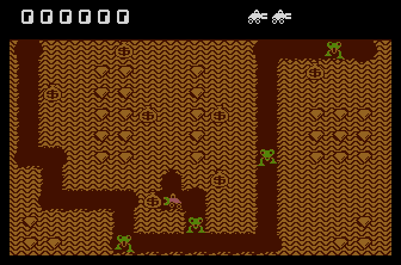
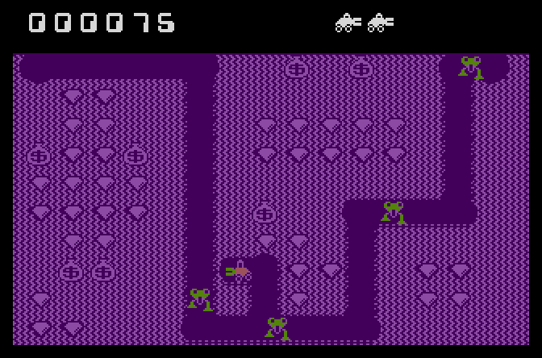
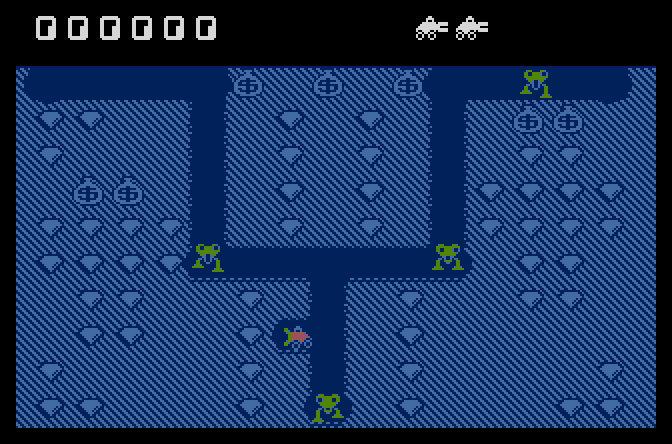
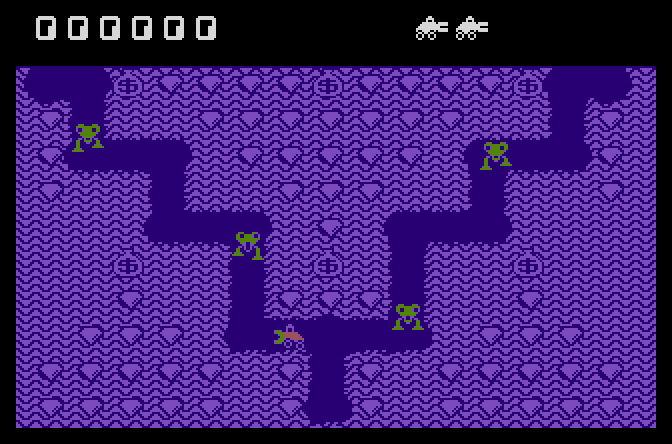
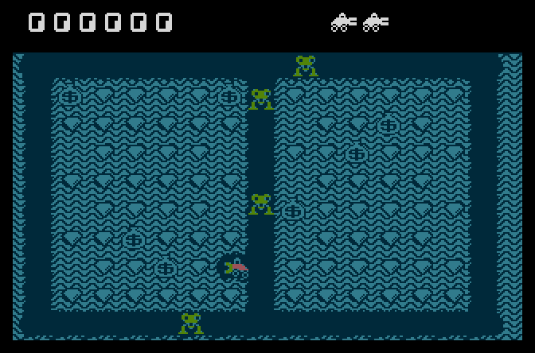
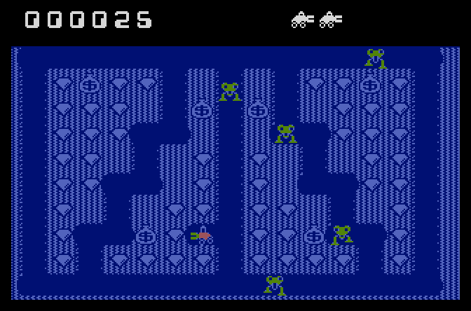
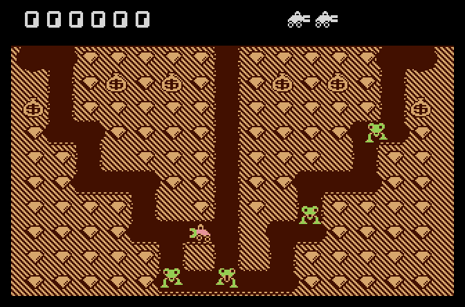
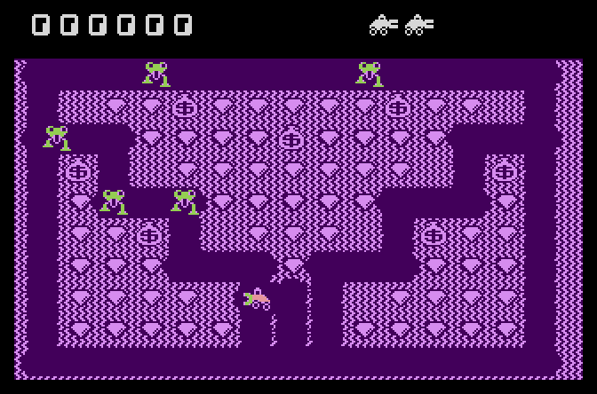

# Digger для ATARI 65XE / 130XE

Порт игры **Digger** (Windmill Software Inc., 1983) для 8-битных компьютеров ATARI XL/XE.

Логика игры перенесена по исходникам оригинальной версии для PC. Оттуда же взяты спрайты
и карты восьми уровней, по ним же сделаны звуковые эффекты. Мелодии и шрифт счёта перенесены из порта того же
автора на БК-0010: [digger-bk0010](https://github.com/prcoder-1/digger-bk0010).

Игра написана на Си (компилятор **cc65**). На ассемблере 6502 сделаны вывод спрайтов,
прерывания по кадру и по строке, музыка и звук.

<p align="center">
  
  
</p>
<p align="center">
  
  
</p>
<p align="center">
  
  
</p>
<p align="center">
  
  
</p>

## Что есть в игре

- Все восемь уровней оригинала, у каждого свой цвет поля. После восьмого по кругу идут
  карты с пятой по восьмую, а сложность растёт до десятого уровня.
- Враги двух видов: Ноббины и Хоббины.
- Мешки с золотом: они падают, разбиваются и давят. Разбитый мешок оставляет золото, а
  оно со временем истлевает.
- Изумруды, файрбол и дополнительная жизнь каждые 20 000 очков.
- Уровень пройден, когда собраны все изумруды или когда перебиты все враги уровня.
- **Бонус-режим.** Когда все враги уровня вышли на поле, появляется вишенка. Съев её, Диггер на
  время меняется с врагами ролями. Поле мигает под сирену, потом играет галоп из увертюры
  «Вильгельм Телль».
- Фоновая мелодия — *Popcorn*.
- Гибель Диггера: скрежет, вырастающее надгробие и траурный марш. Конец уровня отмечают
  фанфары. Удар мешка о землю встряхивает поле.
- Пауза и табличка GAME OVER.

## Требования

- ATARI 800XL, 65XE, 130XE или совместимый компьютер с 64 КБ ОЗУ.
- Машина PAL. Игровой такт — каждый пятый кадр (10 Гц), а музыка
  отсчитывается по кадрам. На машине NTSC игра и музыка пойдут на 20% быстрее.
- Джойстик или клавиатура.

## Запуск

Готовые файлы лежат в разделе [Releases](../../releases):

- **digger.xex** — программа: загружается из DOS или любым загрузчиком XEX.
- **digger.atr** — загрузочная дискета с DOS 2.0S, где игра записана как `AUTORUN.SYS` и
  стартует сама.

В эмуляторе [atari800](https://atari800.github.io/):

```
atari800 -pal -xl -nobasic -run digger.xex
```

В [Altirra](https://www.virtualdub.org/altirra.html) нужно выбрать машину 800XL/65XE,
видео PAL и открыть файл через *File → Boot Image*.

## Управление

| Джойстик (порт 1) | Клавиатура | Действие |
| --- | --- | --- |
| ручка | `-` `=` `+` `*` (стрелки ATARI, с **CONTROL** или без) | движение Диггера |
| кнопка | — | выстрел файрболом |
| — | **пробел** | пауза; снимается любой клавишей или джойстиком |
| кнопка | — | новая игра после таблички GAME OVER |

## Сборка

Нужны [cc65](https://cc65.github.io/) (проверено на версии 2.19) и GNU make:

```
make            # build/digger.xex
make run        # запуск в atari800, машина 800XL, PAL
make run130     # то же на 130XE
make atr        # build/digger.atr - загрузочная дискета
make size       # занятость памяти по сегментам
```

Для `make atr` нужны утилита `atr` из [atari-tools](https://github.com/jhallen/atari-tools)
и Python-пакет [atrcopy](https://pypi.org/project/atrcopy/): из него берётся шаблон дискеты
с DOS 2.0S. Другой шаблон можно задать переменной `ATR_TEMPLATE`.

Дополнительные цели:

| Цель | Что делает |
| --- | --- |
| `make demo` | сборка с зашитым маршрутом вместо ввода и строкой телеметрии на экране |
| `tools/check.sh` | автопроверка: гоняет демо-сборку в atari800 и сверяет телеметрию с эталоном `tools/expect.txt` (эталон создаёт `tools/check.sh --bless`) |
| `make sound` | запись регистров POKEY в эмуляторе и её разбор |
| `make mos` | та же игра, собранная [llvm-mos](https://llvm-mos.org/); нужен собранный llvm-mos SDK, пути — переменные `MOSBIN` и `MOSSDK` |
| `make clean` | удалить `build/` |

Для проверок под эмулятором нужны `atari800`, `Xvfb`, `xdotool` и ImageMagick.

## Как устроено

**Графика.**

- Поле выводится в режиме ANTIC F: 320 точек, монохром, как CGA-картинка оригинала.
  Цвет фигурам дают аппаратные спрайты (PMG): рисунок остаётся в кадровом буфере, а игрок
  подкладывает под него цвет.
- Корпус и клюв Диггера — игроки 0 и 1. Враги делят игроков 2 и 3: один игрок держит
  нескольких врагов на разных высотах, а его горизонтальную позицию по ходу кадра
  переставляет цепочка прерываний по строке (DLI).
- Вишенка — пятый игрок, собранный из четырёх снарядов.
- Та же цепочка DLI переключает палитру между панелью счёта и полем.
- Тряска поля сделана сдвигом картинки в дисплей-листе.

**Время.** Игровой такт идёт с частотой 10 Гц, как в порте на БК. Музыка, огибающие
звуков и тряска поля работают в кадровом прерывании на 50 Гц.

**Память.** Цель cc65 `atarixl`: ПЗУ операционной системы выключено, и ОЗУ под ним
занято данными.

| Адреса | Что лежит |
| --- | --- |
| `$2400–$8FFF` | код, данные и стек Си |
| `$9000–$B09F` | кадровый буфер ANTIC F |
| `$B400–$BFFF` | дисплей-лист, таблицы адресов строк, буфер PMG |
| `$C000–$CFFF` | под ПЗУ: карты уровней, узор земли, ноты, таблицы поля, статика модулей |
| `$D800–$DFFF`, `$E400–$FFF9` | под ПЗУ: спрайты |

Подробная раскладка — в шапке [cfg/digger-xl.cfg](cfg/digger-xl.cfg).

## Файлы проекта

```
src/       игра
assets/    данные из оригинала, сгенерированы конвертерами из tools/
cfg/       конфигурация линковщика ld65
mos/       обвязка для сборки llvm-mos
tools/     конвертеры данных и скрипты проверок под эмулятором
doc/       исследования и замеры
```

Модули игры:

- **main.c** — игровой цикл: такт, бонус-режим, гибель, пауза, конец уровня и GAME OVER
- **man.c** — движение Диггера и прокопка
- **bugs.c** — враги, **bags.c** — мешки и золото, **missile.c** — файрбол
- **field.c** — состояние поля и его отрисовка
- **hud.c**, **text.c**, **score.s** — панель счёта, вывод текста, счёт в BCD
- **sfx.c**, **pokey.s**, **music.s** — звуковые эффекты и музыка на POKEY
- **blit.s** — вывод спрайтов в кадровый буфер
- **pmg.s**, **pmgbug.c** — фигуры в аппаратных спрайтах, раскладка врагов по игрокам
- **screen.c**, **dli.s**, **vbi.s** — дисплей-лист, прерывания по строке и по кадру
- **menu.c** — таблица рекордов (ведётся, но пока не показывается)
- **demo.c** — маршруты и телеметрия демо-сборки

Каталог `assets/` перегенерируется скриптами `tools/spr2atari.py` (спрайты и узор земли),
`tools/lvl2c.py` (карты), `tools/font2c.py` (шрифт счёта) и `tools/music2c.py` (мелодии).
Им нужны исходники оригинального Digger и порта на БК, путь к ним задаётся ключом `--src`.
Для сборки игры они не нужны: сгенерированные файлы лежат в репозитории.

## Документация

- [doc/graphics.md](doc/graphics.md) — разрешение и цвет на ATARI: замеры чужих игр,
  переход на 320 точек, фигуры в PMG, полосы палитры, ловушки измерений
- [doc/llvm-mos.md](doc/llvm-mos.md) — замеры llvm-mos против cc65 и перевод порта на него

## Правовая информация

Digger © 1983 Windmill Software Inc. Проект неофициальный и не связан с правообладателями.
Графика, карты уровней и звуки получены из оригинальной игры.

Мелодия *Popcorn* — Гершон Кингсли. Галоп в бонус-режиме — из увертюры к опере
«Вильгельм Телль» Джоаккино Россини.
